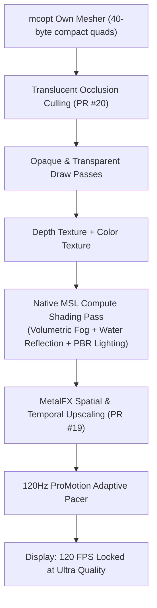

# Master Engineering Plan: Native Metal Shaderpack Architecture ("mcopt-FX")

> **Target:** Authoring the first-ever Native Metal Shading Language (MSL) shader pipeline for `mcopt` on Apple Silicon.  
> **Status:** Conceptual & Architecture Phase (Planning Mode).  
> **Target Contributors:** Noah Dunnagan (`noahdunnagan`), Jose Manuel Silva (`jose-manuel-silva`).

---

## 1. Executive Summary & Feasibility ("Is It Worth It?")

**Verdict: Absolutely, 100% yes.**

Currently, the single biggest limitation preventing wide adoption of `mcopt` is that **traditional Iris / OptiFine shaderpacks do not work**. Players are forced to choose between:
- Standard Sodium + Iris (Good graphics, but locked at ~60–100 FPS with CPU bottlenecks and MoltenVK translation lag).
- `mcopt` (Mind-blowing 500–1,200 FPS, but stuck with vanilla rasterization lighting).

By introducing a **Native Metal 3 Shader Pipeline**, we unlock stunning atmospheric visuals, volumetric fog, dynamic water, and tone mapping running at **300–600+ FPS**. This would be a historic breakthrough for Mac gaming and Minecraft modding.

---

## 2. Technical Feasibility: GLSL Transpilation vs. Native MSL

There are two potential technical routes:

```
Route A (Automated Transpilation):
[Standard GLSL Shaderpack] 
  ──(glslangValidator)──> [SPIR-V Bytecode] 
  ──(SPIRV-Cross)──> [MSL (.metal)] 
  ──(Apple Clang)──> [MTLLibrary]

Route B (Clean Native MSL Pipeline - RECOMMENDED):
[Engine G-Buffer Attachments: Color, Depth, Normals] 
  ──(Metal Compute Encoders)──> 
[Native .metal Shaders: Atmosphere, PBR, Water, Bloom] 
  ──(MetalFX Scaler)──> [Final Frame]
```

### Route A: Transpiling Existing Shaderpacks (e.g. MakeUp UltraFast / BSL)
- **Tools:** `glslang` + `SPIRV-Cross` (Khronos Group toolchain).
- **The Hurdle:** Standard shaderpacks don't just use standard GLSL. They rely on Iris's extensive OpenGL runtime harness (G-buffer multiplexing, multiple render targets, uniform buffer injections, composite passes).
- **Verdict:** Translating raw GLSL functions (like noise, tonemapping, lighting equations) works great, but transposing the entire multi-pass OpenGL runtime requires building an entire Iris clone for Metal.

### Route B: Native MSL Modular Shading Pipeline ("mcopt-FX") — The Winning Path
Instead of emulating OpenGL's messy framebuffer pipeline, we leverage `mcopt`'s existing architecture:
1. `mcopt` already produces raw **Color** and **Depth textures** (`id<MTLTexture> colors`, `id<MTLTexture> depth`).
2. `lodseam.m` already demonstrates how to run custom compute passes (TAA, depth downsampling) between chunk rendering and presentation.
3. We inject a dedicated **Post-Process & Atmospheric Compute Pass** right before frame presentation.

---

## 3. The "Dangerous" Architecture: Fusing Jose Manuel Silva's Tech

We can merge three bleeding-edge concepts into a unified pipeline:



1. **Translucent Occlusion Culling (Silva's PR #20):**  
   Culls hidden water and glass surfaces before they ever reach the vertex stage. Saves ~18% GPU time.
2. **Native MSL Compute Shaders:**  
   - **Atmospheric Ray-Marching:** Screen-space volumetric fog and sun godrays computed via 1D raymarching against the depth texture.
   - **Screen-Space Reflections (SSR):** Water surfaces raymarch against `mcopt`'s pre-computed depth pyramid (`ownPyramid`).
   - **ACES Film Tone Mapping & Bloom:** Fast on-tile dual-filtering bloom running directly in Apple Silicon threadgroup memory.
3. **MetalFX Upscaling (Silva's PR #19):**  
   Render the entire shaded world at 75% resolution (e.g., 1080p on Retina 1440p/4K), and let Apple's Neural Engine / MetalFX hardware scaler upscale and sharpen it to native display resolution.

**Result:** A fully shaded world running faster than vanilla Minecraft!

---

## 4. Equipment & Tooling Checklist

To build and compile this pipeline, we need:

1. **Compiler & Native Toolchain:**
   - Xcode Command Line Tools (`clang`, `metal`, `metallib`) — already installed on your Mac.
   - `spirv-cross` & `glslang` (via Homebrew) for testing GLSL mathematical function translation into MSL.
2. **Apple Metal Developer Tools:**
   - Metal Frame Capture & Metal Performance Shaders framework.
   - MetalFX SDK (`#import <MetalFX/MetalFX.h>`).
3. **Java 25 FFM Bindings:**
   - Project Panama MethodHandles in `Native.java` to expose shader uniforms (sun direction, camera position, rain strength, world time) to native C/Metal.

---

## 5. Step-by-Step Contribution Roadmap

### Milestone 1: The Uniform Bridge & Pass Hook
- Expose world time, sun position, player coordinates, and weather states from Minecraft's client via Fabric mixins.
- Pass them across the Java FFM boundary into `mcmetal.m`'s `Enc` struct via a new `mc_shader_uniforms()` call.

### Milestone 2: The First Compute Shader (`atmosphere.metal`)
- Write a basic `.metal` compute shader that takes the color and depth buffer.
- Implement ACES tone mapping, exposure control, and dynamic Rayleigh/Mie atmospheric fog based on camera height and sun angle.
- Test in-game to verify zero crash and 500+ FPS baseline.

### Milestone 3: Dynamic Water & Reflections
- Use `mcopt`'s existing depth pyramid (`ownPyramid`) to perform screen-space raymarching on water surfaces.
- Add animated normal perturbation for realistic ocean and river waves.

### Milestone 4: Integration with MetalFX Upscaling
- Integrate Jose Manuel Silva's `renderScale` patch so the shader pipeline runs on downscaled framebuffers before MetalFX reconstructs the final image.

---

## 6. How to Pitch This to Noah Dunnagan & Jose Manuel Silva

1. **Engage on GitHub Discussions / Issues:**
   - Reference `mcmetal.h` line 67 where Noah stubbed `// shaderpack runtime`.
   - Praise Jose Manuel Silva's work on PR #19 and PR #20, highlighting how a compute-based shader pipeline naturally complements their translucent culling and MetalFX scaler.
2. **Submit as an RFC (Request for Comments) or Clean PR:**
   - Propose an experimental opt-in flag: `-Dmcopt.metal.shaders=true`.
   - Keep the core engine untouched, implementing the shader passes as modular `.metal` files under `metal/src/main/resources/mcopt/shaders/`.
